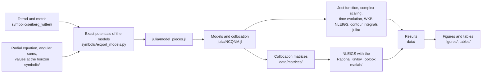

<!-- Authors: Davide Batic, Dr. Denys Dutykh (Mathematics Department, Khalifa University of Science and Technology, Abu Dhabi, UAE), Stefan Güttel (Department of Mathematics, The University of Manchester, UK) and Narges Heidari (Faculty of Physics, Shahrood University of Technology, Iran) -->

# Noncommutative Schwarzschild black holes at second order: codes and data

Davide Batic¹, Denys Dutykh¹, Stefan Güttel² and Narges Heidari³

¹ Mathematics Department, Khalifa University of Science and Technology, PO Box 127788, Abu Dhabi, United Arab Emirates<br>
² Department of Mathematics, The University of Manchester, Manchester M13 9PL, United Kingdom<br>
³ Faculty of Physics, Shahrood University of Technology, Shahrood, Iran

Corresponding author: Davide Batic, davide.batic@ku.ac.ae

This repository accompanies the article *Noncommutative Schwarzschild black holes at second order: the correct metric, a branch cut at the horizon, and the quasinormal spectrum by eight methods*. It contains the exact computations behind its theorems, the codes of the eight methods that compute its quasinormal spectrum, and the data and scripts of every table and figure.

## The article

The Schwarzschild black hole deformed by a Moyal noncommutativity between the radius and the polar angle, `[r, θ] = iΘ`, and constructed with the Seiberg–Witten map at second order in the noncommutativity parameter Θ, is the basis of a growing literature on black-hole ringing, absorption, shadows and thermodynamics. The article shows that neither published version of this second-order metric is correct. The original construction of Chaichian, Tureanu and Zet (2008) misses one contraction term of the deformed tetrad and the Moyal product in the azimuthal component of the metric; the reconstruction of Jurić, Kumara and Požar (2025) restores both but doubles every second-order term of the tetrad through a wrong normalisation of the Seiberg–Witten map. The correct metric is, up to terms of order Θ⁴,

```text
g_tt = −(1 − 2M/r) − M(4r − 11M) Θ² / (4r⁴)
g_rr = (1 − 2M/r)⁻¹ − M(2r − 3M) Θ² / (4r² (r − 2M)²)
g_θθ = r² + (1/16 − M/r + M/(8(r − 2M))) Θ²
g_φφ = r² sin²θ + (5 cos²θ/16 + (r² − 3Mr + M²) sin²θ / (4r (r − 2M))) Θ²
```

In the first-order reduction of Chen, Chiang and Tsao, the scalar wave equation of this metric, and equally that of the 2008 metric, has an effective potential that stays negative at the horizon. For every ℓ ⩾ 1 and 1 ⩽ |m| ⩽ ℓ, the horizon and the value of the potential there are

```text
r_h = 2M + Θ²/(32M) + O(Θ⁴/M³),

V_h = V_eff(r_h) = −[3ℓ(ℓ+1) − (2ℓ+1)|m|] Θ² / (256 M⁴) + O(Θ⁴/M⁶) < 0.
```

The frequency ω therefore enters the horizon condition through the square root `√(ω² − V_h)`: the quasinormal modes are eigenvalues of a nonlinear problem with a branch cut between the branch points `±i√|V_h|`, and the truncated wave equation admits growing waves, whose largest exponential rate is exactly `√|V_h|`. Eight methods agree on the tones: spectral collocation, solved by a Joukowski map, by the fully rational Krylov method NLEIGS, by contour integrals and by Newton's method; the Jost function, which fixes the tones to nearly sixty digits; exterior complex scaling; time evolution; and WKB to high order with Padé approximants. They give the shifts of the tones and their splitting in the azimuthal number, and they correct the frequencies published for the 2008 metric, whose third-order WKB errors are at least half of the effect they report. With the doubled metric of 2025, the potential acquires a pole just inside the horizon and a step of fixed height that reorganises the whole spectrum.

The codes and the data use units in which the mass is M = 1, and a tone is quoted as Mω.

## How to cite

The article to cite is the following.

```text
D. Batic, D. Dutykh, S. Güttel and N. Heidari, Noncommutative Schwarzschild black holes at
second order: the correct metric, a branch cut at the horizon, and the quasinormal spectrum
by eight methods (2026).
```

The file `CITATION.cff` gives the same reference to the button *Cite this repository* of GitHub.

## The metrics and their names in the code

The codes refer to the metrics of the article by short names.

| Name | Metric |
|---|---|
| `swc` | the correct second-order metric of the article, twist `[r, θ] = iΘ` |
| `ctz` | the metric of Chaichian, Tureanu and Zet (2008), same twist |
| `jkp_rth` | the metric of Jurić, Kumara and Požar (2025), same twist, whose second-order terms are doubled |
| `swc_tth` | the correct deformation for the twist `[t, θ] = iΘ` |
| `jkp_tth` | the deformation of Jurić, Kumara and Požar for the twist `[t, θ] = iΘ` |
| `schwarzschild` | the undeformed black hole |

## Contents

The folder `symbolic/` holds the exact computations, in SymPy. Its subfolder `seiberg_witten/` derives the deformed tetrad and metric twice, independently: `tetrad_from_sw_equation.py` solves the Seiberg–Witten differential equation in Taylor series for the de Sitter gauge fields of the Schwarzschild solution (and, with the argument `t-theta`, for the twist `[t, θ] = iΘ`), while `final_results.py` contracts the second-order formula of Chamseddine with the factor 1/32. The script `check_sw_prefactor.py` compares the factors 1/32 and 1/16 (Taylor coefficients against the fixed-point reading, gauge equivalence, the constant abelian field), and `check_a_ctz.py`, `check_b_jkp.py`, `check_c_metric.py`, `check_c_metric_variants.py` and `check_d_t_theta.py` compare the published formulas with the computation. Each of these scripts has its printout in a `.txt` file of the same name. In `symbolic/` itself, `master_equation.py` derives the radial equation by projection and a Liouville transformation and compares it with the master equation of Chen, Chiang and Tsao, `potentials.py` checks the closed forms of the angular sums, summing the series exactly, and `legendre_integrals.py` the integrals of the associated Legendre functions behind them (both with their printouts), `horizon_theorems.py` the residue lemma and the values of the potential at the horizon, `chaichian_metric.py` the effect of the Moyal product on the metric of Chaichian, Tureanu and Zet, and `export_models.py` writes the exact coefficients of every model to `julia/model_pieces.jl`.

The folder `julia/` holds the numerical methods: `NCQNM.jl` (the models, the factorised radial equation, Chebyshev collocation, the quartic Joukowski pencil and Newton's method in any arithmetic), `nepsolvers.jl` (NLEIGS and Beyn's contour integral), `leaver.jl` (Leaver's continued fraction for Schwarzschild), `jost.jl` (the Jost function in 256-bit arithmetic), `ECS.jl` (exterior complex scaling), `TimeDomain.jl` (characteristic grid, method of lines and matrix pencil) and `wkb.jl` (WKB to thirteenth order with Padé approximants). Its subfolder `julia/scripts/` holds the scripts that produce the data.

The MATLAB function `matlab/nleigs_driver.m` is the second realisation of NLEIGS, with the Rational Krylov Toolbox; it reads the collocation matrices written by `julia/scripts/export_matrices.jl` into `data/matrices/`, which are not stored here because that script regenerates them.

The folder `data/` holds the results as CSV files, `figures/` the scripts that draw the figures of the article (with `manuscript_style.py`, a fixed copy of the figure style), and `tables/` the scripts that format its two longest tables. The diagram shows how the pieces feed one another.



## Tables and figures of the article

| Item | Data | Produced by |
|---|---|---|
| Coefficients of Θ² in the three metrics (table) | the printouts `symbolic/seiberg_witten/*.txt` | `symbolic/seiberg_witten/final_results.py` and `tetrad_from_sw_equation.py` for the correct metric, `check_a_ctz.py`, `check_b_jkp.py` and `check_c_metric.py` for the published ones |
| Comparison of the methods (table) | `data/comparison/methods.csv` | `julia/scripts/method_comparison.jl` |
| Tones of the correct metric (table) | `data/production/tones.csv`, `data/production/second_overtone_l1.csv` | `julia/scripts/production.jl`, `julia/scripts/second_overtone_l1.jl` |
| First-order coefficients (table) | `data/production/first_order.csv` | `julia/scripts/production.jl`, formatted by `tables/firstorder_table.py` |
| Late-time growth (table) | `data/timedomain/growth_*.csv`, `data/timedomain/boundstates_*.csv` | `julia/scripts/td_growth.jl`, run once for each of `swc`, `ctz`, `jkp_rth` and `jkp_tth` |
| Published tones and exact tones (table) | `data/production/published_points.csv`, `data/wkb/ctz_heidari_comparison.csv` | `julia/scripts/published_points.jl`, `julia/scripts/wkb_ctz_heidari.jl`, formatted by `tables/heidari_rows.py` |
| The potential near the horizon (figure) | `data/timedomain/tortoise_*.csv`, `data/timedomain/jkp_rth_step.csv` | `julia/scripts/td_tortoise.jl`; drawn by `figures/fig_potential.py` |
| The methods compared (figure) | `data/figures/convergence_swc_l1m1_Th0p5.csv`, `data/comparison/methods.csv` | `julia/scripts/figure_data.jl`, `julia/scripts/method_comparison.jl`; drawn by `figures/fig_methods.py` |
| The Joukowski pencil (figure) | `data/figures/joukowski_swc_l1m1_Th1.csv` | `julia/scripts/figure_data.jl`; drawn by `figures/fig_joukowski.py` |
| Exterior complex scaling (figure) | `data/scaling/continua.csv` | `julia/scripts/ecs_continua.jl`; drawn by `figures/fig_scaling.py` |
| Tones against Θ² (figure) | `data/figures/fundamentals_vs_theta2.csv`, `data/wkb/ctz_heidari_comparison.csv` | `julia/scripts/published_curves.jl`, `julia/scripts/wkb_ctz_heidari.jl`; drawn by `figures/fig_published.py` |
| Ringdown and growth (figure) | `data/timedomain/series_*.csv`, `data/timedomain/spacetime_swc_l1m1_Th0.50.csv` | `julia/scripts/td_schwarzschild.jl`, `julia/scripts/td_growth.jl`, `julia/scripts/td_spacetime.jl`; drawn by `figures/fig_growth.py` |
| The spectrum of the doubled metric (figure) | `data/scaling/jkp_rth_tracks.csv` | `julia/scripts/ecs_jkp_rth.jl`; drawn by `figures/fig_doubled.py` |

The reference values are the zeros of the Jost function in `data/jost/`, for the correct metric with ℓ ⩽ 3, the metric of Chaichian, Tureanu and Zet and the doubled metric with ℓ ⩽ 2, and the twist `[t, θ] = iΘ`; they are computed by `julia/scripts/jost_production.jl` (run as `jost_production.jl swc 3 1`, for instance), checked against Leaver's continued fraction by `julia/scripts/jost_validate_schwarzschild.jl`, and gathered by `julia/scripts/jost_summary.jl`, with the digits on which the collocation agrees with them, into `data/jost/jost_vs_collocation.csv`. The Schwarzschild tests of the other methods are `julia/scripts/validate_schwarzschild.jl` (collocation), `julia/scripts/ecs_validate.jl` (complex scaling), `julia/scripts/td_schwarzschild.jl` (time evolution) and `julia/scripts/wkb_validate.jl` (WKB). The tones of the deformed metrics by complex scaling, by time evolution and by WKB are computed by `julia/scripts/ecs_production.jl`, `julia/scripts/td_ringdown.jl` (run once with the argument `swc` and once with `ctz jkp_tth`) and `julia/scripts/wkb_models.jl`; the comparison of the methods reads them, with the zeros of the Jost function and the results of the MATLAB driver. Run without argument, `td_growth.jl` and `td_ringdown.jl` treat every model at once and write files ending in `_all.csv`, which no other script reads. The script `julia/scripts/td_jkp_rth_step.jl` follows waves across the step of the doubled metric and measures its echo and its late tone.

## Running the codes

The Julia codes need Julia 1.12 or later. The packages are listed in `julia/Project.toml`, and `julia/Manifest.toml` records the versions with which the scripts were last run (Julia 1.13.3, NonlinearEigenproblems 1.1.1, Polynomials 4.1.6); they are installed once by

```text
julia --project=julia -e 'using Pkg; Pkg.instantiate()'
```

after which every script runs from the root of the repository, for instance

```text
julia --project=julia julia/scripts/production.jl
```

With Julia 1.12, Pkg warns that the manifest was resolved with another version of Julia; the warning is harmless. The Jost function and the time evolution use several threads when Julia is started with them, as in `julia -t 8 --project=julia ...`, and their results do not depend on the number of threads. With two threads each, the scripts take from a few seconds to about twenty minutes (complex scaling of the doubled metric), and `jost_production.jl` about five minutes for ℓ = m = 1; `production.jl`, which refines some 840 tones in 256-bit arithmetic, takes over an hour.

The results computed in 256-bit arithmetic (the Jost function, Newton's method, WKB, Leaver's continued fraction) are reproduced to every digit stored. Those computed in double precision (the Joukowski pencil, NLEIGS, contour integrals, complex scaling, the fits of the time evolution) are reproduced to about the accuracy that the data record beside them (the gap between two degrees of the collocation, the spread of a fit), since their last digits depend on the linear-algebra library and on the number of its threads; a fit of the time evolution may then settle on a neighbouring time window, and complex scaling may keep or drop its deepest overtone, whose spread lies near the threshold of acceptance. Errors at the level of rounding, as in the comparison of the methods, change from one run to the next and keep their order of magnitude; NLEIGS of NEP-PACK, moreover, starts from a random vector.

The Python scripts need Python 3 with the packages of `requirements.txt` (SymPy, NumPy, Matplotlib), installed for instance by `python3 -m pip install -r requirements.txt`; they were last run with SymPy 1.14.0, NumPy 2.5.4 and Matplotlib 3.10.7. They run from any folder, for instance `python3 symbolic/seiberg_witten/tetrad_from_sw_equation.py` or `python3 figures/fig_growth.py`, each in a few seconds to about a minute. With these versions every symbolic script with a printout reproduces it exactly, so that

```text
python3 symbolic/seiberg_witten/check_sw_prefactor.py | diff - symbolic/seiberg_witten/check_sw_prefactor.txt
```

prints nothing. The figures set their text with LaTeX in Latin Modern, so a LaTeX installation is needed for them; with `FIGURE_USETEX=0` they are drawn without LaTeX, in another font. Before it is saved, each figure is checked for a label, a legend or a colour bar that crosses a curve or another label, and refused if one does; with other fonts such a crossing may appear, and `FIGURE_FORCE=1` then writes the figure all the same. The figures are written to `figures/pdf/`, and with LaTeX they reproduce those of the article.

The MATLAB driver needs the matrices of `data/matrices/`, written by

```text
julia --project=julia julia/scripts/export_matrices.jl
```

and the Rational Krylov Toolbox on the MATLAB path; the toolbox is available at

https://rktoolbox.org/

The five files of `data/nleigs/` come from the following calls, made in MATLAB from the folder `matlab/`. The second, for instance, computes the tones of the correct metric for ℓ = m = 1 and Θ = 0.5 M inside the quadrilateral with the four vertices given, with the shift 0.3 − 0.1i, and writes them to `data/nleigs/`.

```text
nleigs_driver('ctz_l1_m1_Th0p5_N100', [0.2-0.05i, 0.4-0.05i, 0.4-0.15i, 0.2-0.15i], 0.3-0.1i)
nleigs_driver('swc_l1_m1_Th0p5_N100', [0.2-0.05i, 0.4-0.05i, 0.4-0.15i, 0.2-0.15i], 0.3-0.1i)
nleigs_driver('swc_l1_m1_Th0p5_N100', [0.15-0.05i, 0.6-0.05i, 0.6-0.4i, 0.15-0.4i], 0.3-0.2i)
nleigs_driver('swc_l2_m1_Th0p5_N100', [0.4-0.05i, 0.6-0.05i, 0.6-0.35i, 0.4-0.35i], 0.48-0.2i)
nleigs_driver('jkp_rth_l1_m1_Th0p1_N100', [0.15-0.05i, 0.35-0.05i, 0.35-0.15i, 0.15-0.15i], 0.25-0.1i)
```

## License

The codes and the data are distributed under the GNU Lesser General Public License, version 2.1, whose text is in the file `LICENSE`.
